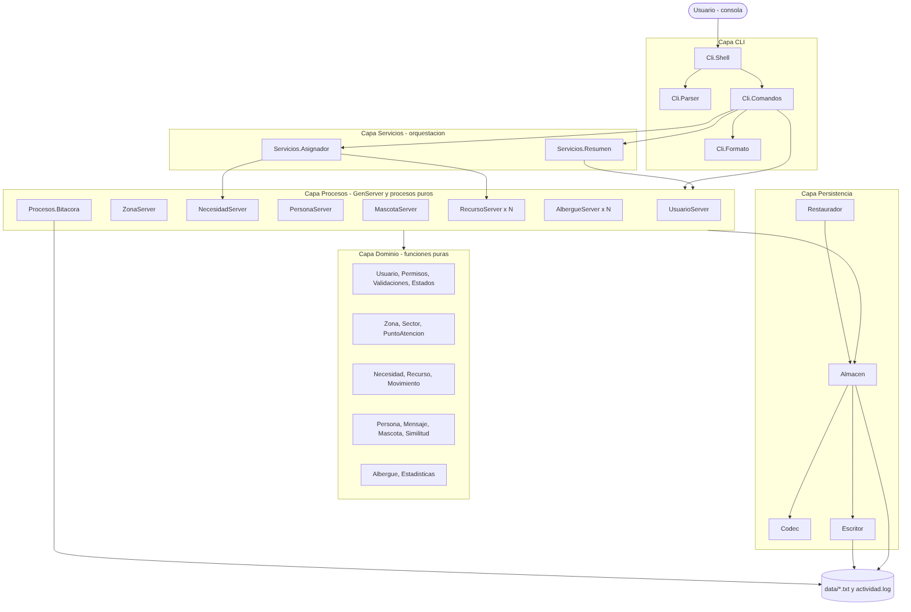
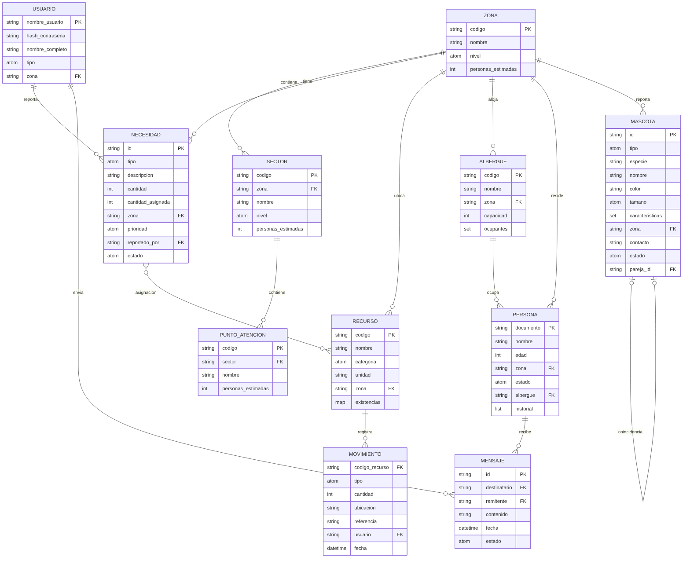
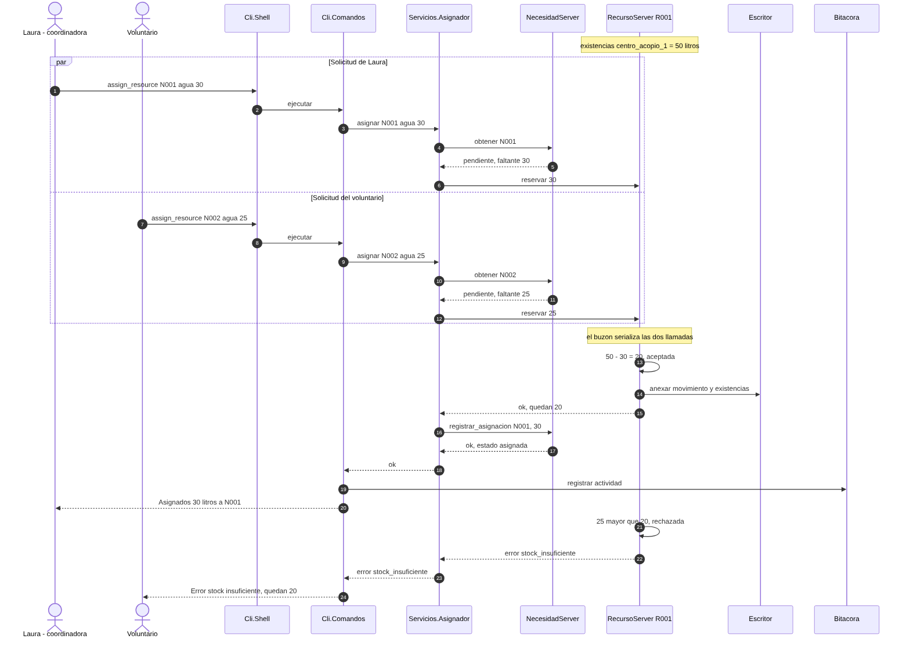
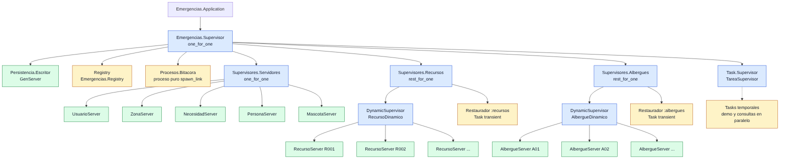

# Proyecto final – Programación III
## Sistema Distribuido de Coordinación y Gestión de Emergencias en Elixir
Universidad del Quindío · Ingeniería de Sistemas y Computación · 2026-2

> Este archivo sigue **la misma numeración y orden del PDF** del proyecto. Se copia a Word/PDF para la entrega.
> Las secciones marcadas **[COMPLETAR]** se llenan cuando el código esté terminado
> (el PDF exige que "los diagramas correspondan al código final").

---

## 1. Definición del proyecto final

### 1.1 Equipo de trabajo

| Nombres completos | Código | Correo |
|-------------------|--------|--------|
| [COMPLETAR] | [COMPLETAR] | [COMPLETAR] |
| [COMPLETAR] | [COMPLETAR] | [COMPLETAR] |
| [COMPLETAR] | [COMPLETAR] | [COMPLETAR] |

### 1.2 Enunciado
Ver PDF del curso. Resumen: plataforma multiusuario y concurrente, en Elixir, para coordinar la atención posterior a un terremoto (usuarios, zonas, necesidades, recursos, familiares, mascotas y albergues) con GenServer, supervisión, persistencia en texto plano y sin inconsistencias ante operaciones simultáneas.

### 1.3 Objetivos de aprendizaje y dónde se evidencian

| Objetivo | Evidencia en el proyecto |
|----------|--------------------------|
| Programación funcional (puras, pattern matching, guards, inmutabilidad) | Capa `Dominio.*`: ninguna función hace I/O ni envía mensajes |
| Estructuras de datos (listas, mapas, tuplas, MapSet, anidadas) | Ver tabla 1.3.1 |
| Algoritmos recursivos | Ver tabla 1.3.2 (7 funciones) |
| Concurrencia y paso de mensajes | `Procesos.Bitacora` (spawn/receive), `Task.Supervisor`, llamadas `GenServer.call` |
| GenServer | 5 servidores estáticos + `RecursoServer` + `AlbergueServer` + `Escritor` |
| Supervisores | Árbol OTP (sección 1.8): `Supervisor` y `DynamicSupervisor` |
| Recursos compartidos / operaciones simultáneas | `RecursoServer` (un proceso por recurso), `AlbergueServer`, `Asignador` con compensación |
| Persistencia en texto plano | `Persistencia.*` + carpeta `data/` |
| Sistema multiusuario | Varias consolas/tareas en paralelo (`mix emergencias.demo`) |
| Justificar decisiones de diseño | `docs/DISENO.md` |

#### 1.3.1 Estructuras de datos utilizadas y justificación

| Estructura | Dónde | Por qué |
|-----------|-------|---------|
| `struct` | Todas las entidades | Campos con nombre y validación en compilación (`@enforce_keys`) |
| Mapa | Estado de cada GenServer (`%{id => entidad}`); `existencias` por ubicación | Acceso por clave en O(log n); actualización inmutable |
| Lista | Historiales, resultados de consultas, cola de necesidades por prioridad | Natural para recursión cabeza/cola y para conservar el orden cronológico |
| Tupla | Resultados `{:ok, v}` / `{:error, razon}`; `{estado, fecha, usuario}`; asignación `{recurso, ubicacion, cantidad}` | Tamaño fijo y significado por posición |
| `MapSet` | Ocupantes de un albergue; características de mascotas; usuarios conectados | Sin duplicados + operaciones de conjunto (Jaccard, pertenencia) |
| Keyword list | Filtros (`zona:`, `prioridad:`) y opciones del parser | Pocas claves, orden y claves repetidas permitidas |
| Árbol anidado | zona → sectores → puntos de atención | Refleja la jerarquía del enunciado; base de la recursión sobre árboles |

#### 1.3.2 Funciones recursivas propias (mínimo exigido: 4)

| # | Función | Qué recorre | Tipo |
|---|---------|-------------|------|
| 1 | `Zona.total_afectados/1` | Árbol zona → sectores → puntos | Árbol |
| 2 | `Zona.buscar_punto/2` | Árbol (profundidad) | Árbol |
| 3 | `Zona.contar_puntos/1` | Árbol | Árbol |
| 4 | `Necesidad.insertar_por_prioridad/2` y `ordenar/1` | Lista | Cabeza/cola |
| 5 | `Asignador.tomar_de_recursos/3` | Lista de recursos candidatos | Cola + acumulador |
| 6 | `Estadisticas.sumar/1`, `contar_si/2`, `agrupar/2` | Lista | Cabeza/cola |
| 7 | `Parser.tokenizar/1`, `Codec.dividir/1`, `Shell.loop/1`, `Bitacora.loop/1` | Caracteres / bucle | Cola |

### 1.4 Requisitos funcionales → módulos

| Req. | Funcionalidad | Módulos principales |
|------|---------------|---------------------|
| 1.4.1 | Gestión de usuarios | `Dominio.Usuario`, `Dominio.Permisos`, `UsuarioServer`, `Procesos.Bitacora` |
| 1.4.2 | Conexión | `UsuarioServer.conectar/4`, `Cli.Sesion` |
| 1.4.3 | Zonas afectadas | `Dominio.Zona/Sector/PuntoAtencion`, `ZonaServer` |
| 1.4.4 | Necesidades | `Dominio.Necesidad`, `NecesidadServer`, `Servicios.Asignador` |
| 1.4.5 | Recursos y centros de apoyo | `Dominio.Recurso/Movimiento`, `RecursoServer` |
| 1.4.6 | Comunicación entre familiares | `Dominio.Persona/Mensaje`, `PersonaServer` |
| 1.4.7 | Mascotas | `Dominio.Mascota/Similitud`, `MascotaServer` |
| 1.4.8 | Albergues | `Dominio.Albergue`, `AlbergueServer`, `Estadisticas.albergues_mas_ocupados/2` |
| 1.4.9 | Persistencia | `Persistencia.Almacen/Codec/Escritor/Restaurador` |
| 1.4.9 | Validaciones y errores | `Dominio.Validaciones`, `Dominio.Estados`, tuplas `{:ok,_}/{:error,_}` |
| 1.4.10 | Comandos | `Cli.Parser`, `Cli.Comandos`, `Cli.Shell` |

### 1.5 Comandos del sistema

Los comandos marcados *(añadido)* no están en la lista de referencia del PDF; se agregaron para cubrir requisitos que el enunciado pide (registrar sectores y puntos de atención, consultar el estado de una zona). El PDF permite modificar los nombres siempre que se conserve la funcionalidad.

| Comando | Rol mínimo | Destino |
|---------|-----------|---------|
| `connect usuario contraseña tipo zona` | todos | UsuarioServer |
| `disconnect` | todos | UsuarioServer |
| `register_zone codigo nombre nivel [personas]` | coordinador | ZonaServer |
| `register_sector zona codigo nombre [nivel] [personas]` *(añadido)* | coordinador | ZonaServer |
| `register_point zona sector codigo nombre [personas]` *(añadido)* | coordinador | ZonaServer |
| `list_zones` *(añadido)* | ciudadano | ZonaServer |
| `zone_status zona` *(añadido)* | ciudadano | Servicios.Resumen |
| `register_need tipo cantidad prioridad zona descripcion` | ciudadano | NecesidadServer |
| `list_needs [zona=.. prioridad=.. tipo=.. estado=..]` | ciudadano | NecesidadServer |
| `assign_resource need recurso cantidad` | coordinador | Asignador |
| `register_resource codigo nombre cantidad unidad ubicacion` | coordinador | RecursoServer |
| `list_resources` | voluntario | RecursoServer |
| `transfer_resource codigo origen destino cantidad` | coordinador | RecursoServer |
| `report_person documento nombre zona estado` | ciudadano | PersonaServer |
| `find_person documento` | ciudadano | PersonaServer |
| `send_family_message documento "texto"` | ciudadano | PersonaServer |
| `list_family_messages documento` | ciudadano | PersonaServer |
| `report_pet lost\|found especie nombre color tamano zona contacto` | ciudadano | MascotaServer |
| `match_pets` | ciudadano | MascotaServer + Similitud |
| `register_shelter codigo "nombre" zona capacidad` | coordinador | AlbergueServer |
| `check_shelter codigo` | ciudadano | AlbergueServer |
| `register_entry codigo documento` / `register_exit ...` | voluntario | AlbergueServer |
| `summary` / `critical_resources` | coordinador | Servicios.Resumen |
| `pending_needs` | ciudadano | Servicios.Resumen |

---

## 2. Desarrollo del proyecto final

### 2.1 Diagrama de arquitectura de módulos


### 1.6 Modelo de datos


### 1.7 Diagrama de secuencia
Escenario del PDF: dos asignaciones simultáneas (30 y 25 litros) sobre 50 disponibles.


### 1.8 Diagrama de procesos y supervisión (OTP tree)


---

## 3. Estructuración del proyecto

### 2.1 Estructura del proyecto

```
emergencias/
├── mix.exs
├── config/            (config.exs, dev.exs, test.exs, prod.exs)
├── data/              (archivos de texto plano de persistencia)
├── docs/              (informe, diseño, diagramas)
├── lib/
│   ├── emergencias.ex
│   ├── emergencias/
│   │   ├── application.ex
│   │   ├── cli/            (shell, parser, comandos, formato, sesion)
│   │   ├── dominio/        (módulos puros: usuario, zona, necesidad, recurso, ...)
│   │   ├── servidores/     (GenServer: usuario, zona, necesidad, persona, mascota, recurso, albergue)
│   │   ├── procesos/       (bitacora: proceso puro spawn/receive)
│   │   ├── servicios/      (asignador, resumen)
│   │   ├── persistencia/   (almacen, codec, escritor, restaurador)
│   │   └── supervisores/   (servidores, recursos, albergues)
│   └── mix/tasks/          (emergencias.shell, emergencias.demo)
└── test/                   (espejo de lib/)
```

---

## 4. Demostración

### 4.1 Video de demostración
Guion sugerido (≈5 min), ejecutando `mix emergencias.demo` y luego la consola:
1. Conexión de Laura (coordinadora, zona centro) y registro automático de un usuario nuevo.
2. `register_resource R001 agua 50 litros centro_acopio_1` y dos necesidades (30 y 25 litros).
3. **Conflicto concurrente**: dos asignaciones simultáneas; una se confirma, la otra recibe `stock_insuficiente`.
4. Persona localizada en Albergue Norte + mensaje familiar.
5. Mascota perdida y encontrada → `match_pets` con puntaje → confirmar coincidencia.
6. `summary`, `critical_resources`, `pending_needs`.
7. Matar un `RecursoServer` (`Process.exit/2`) y mostrar que el supervisor lo reinicia con su estado.
8. Mostrar los archivos de `data/` y el árbol de procesos (`:observer.start()`).

**Enlace al video:** [COMPLETAR]

---

## 5. Repositorio

### 5.1 Link del repositorio
[COMPLETAR]

---

## Lista de verificación final

- [ ] El sistema gestiona usuarios.
- [ ] El sistema gestiona zonas y sectores.
- [ ] El sistema gestiona necesidades.
- [ ] El sistema gestiona recursos.
- [ ] Existe comunicación entre familiares.
- [ ] Existe gestión de mascotas perdidas y encontradas.
- [ ] Existe gestión de albergues.
- [ ] Se utilizan varias estructuras de datos justificadas.
- [ ] Existen al menos cuatro funciones recursivas propias.
- [ ] Existen procesos concurrentes.
- [ ] Se utiliza GenServer.
- [ ] Existe Supervisor y/o DynamicSupervisor.
- [ ] Se demuestra un conflicto concurrente resuelto correctamente.
- [ ] Existe persistencia.
- [ ] Existen pruebas.
- [ ] Los diagramas corresponden al código final.
- [ ] Todos los integrantes participan en el repositorio y la sustentación.
